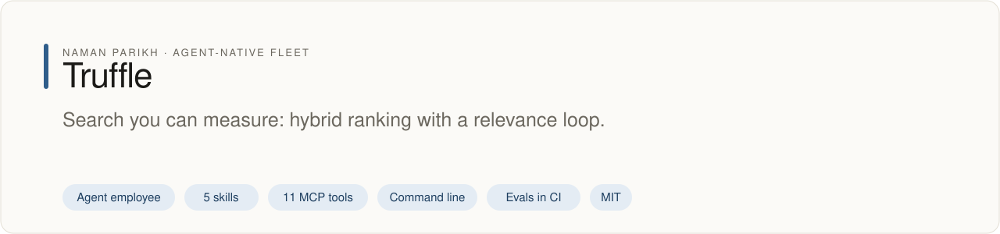
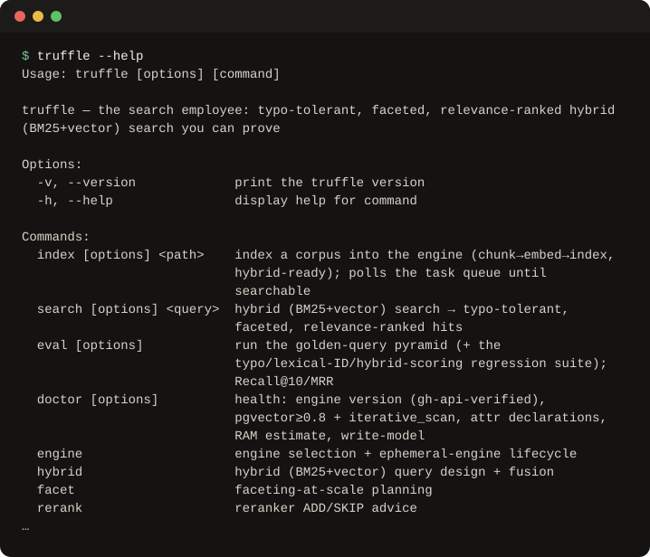

# truffle

<!-- fleet:header:start -->
<p align="center"><picture><source media="(prefers-color-scheme: dark)" srcset="assets/banner-dark.svg"></picture></p>

<p align="center">
<a href="https://github.com/naman10parikh/truffle/actions/workflows/ci.yml"></a>
<a href="https://github.com/naman10parikh/truffle/releases"></a>
<a href="LICENSE"></a>
<a href="#use-it-from-any-coding-agent"></a>
<a href="https://x.com/naman10parikh"></a>
<a href="https://www.linkedin.com/in/naman-parikh1/"></a>
</p>

<p align="center"><a href="#quick-start">Quick start</a> · <a href="docs/README.md">How it works</a> · <a href="AGENTS.md">AGENTS.md</a> · <a href="llms.txt">llms.txt</a> · <a href="skills/">Skills</a> · <a href="https://github.com/naman10parikh/truffle/discussions">Discussions</a> · <a href="https://github.com/naman10parikh">All projects</a></p>

**Search you can measure: hybrid ranking with a relevance loop.**

Truffle is an agent employee, a packaged specialist agent with its own skills, memory and tests. It owns one job: search. Coding agents use it through its skills, its MCP server and its command line. Its evals gate every merge in CI. A person makes every change.

_Truffle is part of an agent-native play for agent-native systems that can eventually be recursively self-improving and evolving, operated by agent employees._

<p align="center"></p>
<!-- fleet:header:end -->

Truffle gives an app search that returns the right ordered results and proves it: typo-tolerant, faceted and relevance-ranked through hybrid search (BM25, vectors and rank fusion), checked by a golden-query eval that catches silent regressions. It is for coding agents, and the developers who drive them, whenever a product needs a search box, retrieval for RAG or a relevance fix. It picks the engine for the corpus (Meilisearch by default), and it is a recursively self-improving, agent-native harness built on the Energy harness formula.

<!-- fleet:use:start -->
## Use it from any coding agent

**Claude Code**: the plugin brings the skills, sub-agents, hooks and MCP server.

```
/plugin marketplace add naman10parikh/truffle
/plugin install truffle@truffle
```

<details><summary>Its MCP server, Codex, Cursor, Gemini CLI, one skill and the command line</summary>

**Its MCP server**, in any MCP client:

```bash
claude mcp add --transport stdio truffle -- npx -y -p github:naman10parikh/truffle truffle-mcp
codex mcp add truffle -- npx -y -p github:naman10parikh/truffle truffle-mcp
```

Cursor (`.cursor/mcp.json`), Gemini CLI (`.gemini/settings.json`) and most other clients take the same command as JSON:

```json
{
  "mcpServers": {
    "truffle": {
      "command": "npx",
      "args": [
        "-y",
        "-p",
        "github:naman10parikh/truffle",
        "truffle-mcp"
      ]
    }
  }
}
```

**Gemini CLI**: the extension brings the context and the MCP server.

```bash
gemini extensions install https://github.com/naman10parikh/truffle
```

**One skill** (5 in all, in [skills/](skills/)), in any agent that reads Agent Skills:

```bash
gemini skills install https://github.com/naman10parikh/truffle --path skills/select-search-engine
git clone --depth 1 https://github.com/naman10parikh/truffle /tmp/truffle && cp -r /tmp/truffle/skills/select-search-engine ~/.claude/skills/
```

**The command line:**

```bash
npx -y -p github:naman10parikh/truffle truffle --help
```

</details>

Codex, Cursor, OpenCode, GitHub Copilot and other agents read [AGENTS.md](AGENTS.md); Claude Code reads [CLAUDE.md](CLAUDE.md) and Gemini CLI reads [GEMINI.md](GEMINI.md), which import it. [llms.txt](llms.txt) maps every surface for agents that read first.
<!-- fleet:use:end -->

## Quick start

```bash
git clone https://github.com/naman10parikh/truffle && cd truffle
pnpm install && pnpm build                                          # tsc → dist/ (the CLI and the MCP server)
node dist/cli/index.js engine select --corpus-size 50000 --multitenant   # Typesense: server-enforced tenant keys win here
node dist/cli/index.js hybrid design --engine postgres              # copy-paste two-CTE RRF SQL (k = 60)
node dist/cli/index.js rerank advise --mrr 0.9 --latency-budget 50  # skip: MRR@5 is already above 0.85
node dist/cli/index.js facet plan brand --cardinality 50000         # the facet-at-scale dials, in order
node dist/cli/index.js tenant key --filter "tenant_id:=42" --engine typesense   # a scoped key the client cannot strip
node dist/cli/index.js brain search "rrf floor"                     # BM25 over the brain: RRF is the floor, not the finish
pnpm test && pnpm eval                                              # 50 tests; 16/16 decision and L1 checks
```

These run offline at no cost. `index`, `search` and the retrieval half of `eval` need a reachable Meilisearch: `node dist/cli/index.js engine up --engine meili` boots one in Docker (it reads `MEILI_URL`, default `http://localhost:7700`), and without one `search` says so instead of inventing hits.

## How it works

- **Boundary first.** Truffle owns the query, the ranking and the relevance proof. The pgvector database and the Postgres box belong to acorn, and the LLM step that reads the top results is downstream.
- **Engine by corpus.** `engine select` answers corpus size and control before naming an engine: Meilisearch by default, Typesense for latency or multitenancy, Postgres with pgvector for one fewer service, Elasticsearch, OpenSearch or Algolia only when justified.
- **Hybrid by default.** BM25 plus vectors plus fusion, because pure vector search loses on codes, SKUs and IDs. Reciprocal rank fusion is the floor; tuned tiered boosts and a reranker come next, each gated by the golden set.
- **One core, two surfaces.** Each of the 11 MCP tools (`src/mcp/server.ts`) maps to one CLI verb (`src/cli/`), and both call the same logic in `src/core/` and `src/runtime/`; the five skills tell an agent when to use which. `route run` chains index, search and eval in order and logs each step.
- **Proof.** The acceptance test indexes a fixture corpus and runs a typo plus lexical-ID hybrid search (`kuburnetes RTX-4090 0x80070005`) that must correct the typo, keep the exact codes and rank RTX-4090 above RTX-4070. CI runs it against a pinned Meilisearch container with committed fixture vectors and no secrets.
- **Never a silent regression.** A PostToolUse hook warns when an edit changes an engine version pin, and `truffle eval --suite version-bump` re-runs the typo, hybrid-scoring and lexical-ID classes. A daily workflow re-checks drift and writes proposals; it never edits on its own.

<!-- fleet:anatomy:start -->
## What it is made of

Every project in this fleet is graded on the same 11 harness components and on self-improvement. Each mark is backed by a file you can open.

| Component | Grade | Where |
| --- | --- | --- |
| Identity | ✅ | identity/SOUL.md:1 identity/BRAND.md:12 |
| Memory | ✅ | identity/MEMORY.md:1 src/cli/commands/brain.ts:3 memory/LEARNINGS.md:5 |
| Skills | ✅ | skills/select-search-engine/SKILL.md:1 skills/search-eval-loop/SKILL.md:1 |
| Tools/CLIs | ✅ | package.json:7 src/cli/index.ts:1 |
| Hooks | ✅ | .claude/settings.json:19 hooks/hooks.json:4 hooks/version-bump-guard.js:1 |
| Sub-agents | ✅ | .claude/agents/relevance-auditor.md:2 .claude/agents/engine-selector.md:2 |
| MCPs | ✅ | src/mcp/server.ts:1 package.json:8 .mcp.json:3 |
| Dispatch | ✅ | src/dispatch/route.ts:94 .github/workflows/rsi.yml:13 |
| Evals | ✅ | eval/eval.mjs:1 .github/workflows/acceptance.yml:53 |
| Observability | ✅ | src/runtime/run-log.ts:36 src/dispatch/route.ts:51 |
| Sandbox/Infra | ✅ | src/sandbox/engine-up.ts:1 .github/workflows/acceptance.yml:17 |
| Self-improvement | ✅ | dsip.json:1 workflows/rsi.workflow.js:86 .github/workflows/rsi.yml:13 |

✅ real and tested · 🟡 partial, with the reason in the row · ❌ absent
<!-- fleet:anatomy:end -->

<!-- fleet:footer:start -->
## How it improves itself

It carries its own evals and a self-improvement contract, [`dsip.json`](dsip.json), which says what it may change and how a change is judged. Its evals gate every merge in CI. A person makes every change. Lessons it learns are kept as rules in its memory files.

## Part of a fleet

One of the projects by [Naman Parikh](https://github.com/naman10parikh). Each owns one part of an agent's harness, or of the product around an agent, and all of them follow one standard.

| Related project | What it owns |
| --- | --- |
| [AgentDial](https://github.com/naman10parikh/agentdial) | Identity |
| [WikiMem](https://github.com/naman10parikh/wikimem) | Memory |
| [Skillsmith](https://github.com/naman10parikh/skillsmith) | Skills |
| [Agent Booster](https://github.com/naman10parikh/agent-booster) | Tools / CLIs |
| [Armory](https://github.com/naman10parikh/armory) | MCPs and the component registry |
| [AgentGrid](https://github.com/naman10parikh/agentgrid) | Dispatch |
| [AgentSwarm](https://github.com/naman10parikh/agentswarm) | Dispatch |
| [AgentBench](https://github.com/naman10parikh/agentbench) | Evals |
| [AgentMoney](https://github.com/naman10parikh/agentmoney) | Observability |
| [Claude Harness](https://github.com/naman10parikh/claude-harness) | The whole harness, as a template |

## Community

Questions and ideas go to [Discussions](https://github.com/naman10parikh/truffle/discussions); bugs go to [issues](https://github.com/naman10parikh/truffle/issues/new/choose). Follow the work on [X](https://x.com/naman10parikh) and [LinkedIn](https://www.linkedin.com/in/naman-parikh1/).

## Contributing and security

Read [CONTRIBUTING.md](CONTRIBUTING.md). AI-assisted pull requests are welcome. Report a vulnerability privately, as [SECURITY.md](SECURITY.md) explains.

## License

MIT, © 2026 Naman Parikh. See [LICENSE](LICENSE) and [NOTICE](NOTICE).
<!-- fleet:footer:end -->
