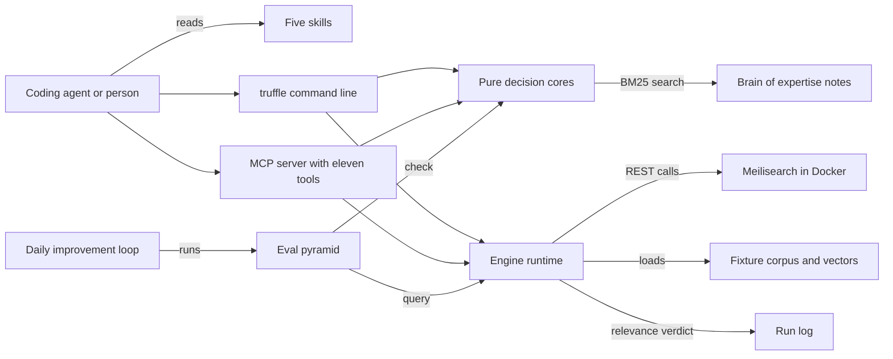

# How Truffle works

Truffle gives an app search that returns the right results in the right order, and proves it with a measured eval. It is for coding agents and their developers, when a product needs a search box, retrieval for an LLM or a relevance fix. It picks the search engine for the corpus, with Meilisearch as the default. It builds hybrid search, which blends keyword ranking with vector similarity. It also catches typos and keeps exact codes such as `RTX-4090`. A golden set of queries checks every change, so a fix for one query cannot silently break another.

## The parts



An agent reaches Truffle through its [skills](../skills/), its command line or its MCP server. MCP (Model Context Protocol) is a standard way for an agent to call tools. The command line starts in [src/cli/index.ts](../src/cli/index.ts), with its verbs in [src/cli/commands/](../src/cli/commands/). The MCP server in [src/mcp/server.ts](../src/mcp/server.ts) is a small hand-written JSON-RPC loop over stdio. Its eleven tools live in [src/mcp/tools/](../src/mcp/tools/), and each maps to one command. Both surfaces call the same code.

The pure cores in [src/core/](../src/core/) need no engine. They choose an engine, fuse rankings, plan facets, check embedding sizes and score relevance. The runtime in [src/runtime/](../src/runtime/) talks to Meilisearch over REST through [src/runtime/meili-client.ts](../src/runtime/meili-client.ts). [src/sandbox/engine-up.ts](../src/sandbox/engine-up.ts) starts a pinned Meilisearch container. The fixtures in [fixtures/](../fixtures/) carry committed vectors, so hybrid search runs without an embedding API. [src/core/brain-index.ts](../src/core/brain-index.ts) searches the notes in [brain/](../brain/) with BM25, a standard keyword ranking. The hook in [hooks/version-bump-guard.js](../hooks/version-bump-guard.js) warns when an edit changes an engine version pin.

## What happens when you run it

The main flow is the acceptance path in [.github/workflows/acceptance.yml](../.github/workflows/acceptance.yml).

1. `truffle engine up --engine meili` runs [src/sandbox/engine-up.ts](../src/sandbox/engine-up.ts), which starts `getmeili/meilisearch:v1.28` with Docker.
2. `truffle index ./fixtures/corpus --hybrid` goes from [src/cli/commands/runtime.ts](../src/cli/commands/runtime.ts) to [src/runtime/index-corpus.ts](../src/runtime/index-corpus.ts).
3. The indexer checks that Meilisearch answers. [src/runtime/corpus.ts](../src/runtime/corpus.ts) reads the Markdown documents and their vectors from [fixtures/vectors/embeddings.json](../fixtures/vectors/embeddings.json).
4. It clears old documents and declares the fields and the embedder. Then it adds the documents and polls the task queue. It reports the index as searchable only after the task succeeds.
5. `truffle search "kuburnetes RTX-4090 0x80070005" --hybrid --facet category` runs [src/runtime/search.ts](../src/runtime/search.ts). It looks up the committed query vector in [fixtures/vectors/queries.json](../fixtures/vectors/queries.json).
6. Meilisearch blends the keyword and vector results. Its typo tolerance fixes "kuburnetes", and the keyword side keeps the exact codes.
7. Search prints the hits, the facet counts and a relevance note, or JSON with `--json`. If a query has no committed vector, it runs keyword search only and says so.
8. `truffle eval` runs [src/runtime/eval-suite.ts](../src/runtime/eval-suite.ts). It scores recall at 10, mean reciprocal rank and hit rate with [src/core/eval-scorer.ts](../src/core/eval-scorer.ts). [src/runtime/run-log.ts](../src/runtime/run-log.ts) appends the verdict to [logs/runs.jsonl](../logs/runs.jsonl).

`truffle route run`, in [src/dispatch/route.ts](../src/dispatch/route.ts), writes three ordered step records: index, search, eval. In this version each step only checks that its runtime module loads. It does not run the step.

## Extending it

- **A command.** Add a file in [src/cli/commands/](../src/cli/commands/) that exports a `register` function, like [src/cli/commands/engine.ts](../src/cli/commands/engine.ts). Call it from [src/cli/index.ts](../src/cli/index.ts). Put pure logic in [src/core/](../src/core/) with a test beside it, like [src/core/fusion.test.ts](../src/core/fusion.test.ts).
- **An MCP tool.** Add a tool to `DETERMINISTIC_TOOLS` in [src/mcp/tools/deterministic.ts](../src/mcp/tools/deterministic.ts), or to `RUNTIME_TOOLS` in [src/mcp/tools/runtime-tools.ts](../src/mcp/tools/runtime-tools.ts) if it needs the engine. List it in `TOOLS` in [src/mcp/tools/index.ts](../src/mcp/tools/index.ts). Update the tool count in [src/mcp/server.test.ts](../src/mcp/server.test.ts).
- **A skill.** Add `skills/<name>/SKILL.md` with a `name`, a `description` and a `brain_source` in its front matter. Copy the shape of [skills/build-hybrid-search/SKILL.md](../skills/build-hybrid-search/SKILL.md).
- **An eval.** Describe the task in [eval/golden/golden-tasks.json](../eval/golden/golden-tasks.json) and add a matching `check()` in [eval/eval.mjs](../eval/eval.mjs). Retrieval tasks also need expected results in [fixtures/golden-expectations.json](../fixtures/golden-expectations.json).
- **Expertise.** Add a scenario, pitfall or opinion to the matching note in [brain/](../brain/). `truffle brain search` finds it at once.

Then run `pnpm build && pnpm test && pnpm eval`. For the full bar, run `bash scripts/acceptance-local.sh`, which needs Docker or a running Meilisearch. CI runs the same steps against a pinned Meilisearch container with no secrets.

## Questions

**Does it need an API key or cost money?**
It needs no model API key. The decision commands run offline at no cost. Indexing, search and the retrieval evals need a reachable Meilisearch. `truffle engine up --engine meili` starts a free local one with Docker. Set `MEILI_URL` and `MEILI_MASTER_KEY` to use another. Hybrid search runs on committed vectors, so no embedding API is called. The trajectory judge notices `ANTHROPIC_API_KEY`, but in this version it runs its rule-based rubric either way.

**Does any data leave the machine?**
The decision commands stay local. Indexing and search send your documents and queries only to the Meilisearch at `MEILI_URL`. `truffle engine up` pulls the engine image through Docker. The daily loop reads the latest engine releases from GitHub with `gh api`. The local page from `bash scripts/serve.sh` serves on port 7787 by default.

**How does it improve itself?**
Its self-improvement contract, [dsip.json](../dsip.json), names one level, `agent`, a nightly loop and `noSelfGrading: true`. [.github/workflows/rsi.yml](../.github/workflows/rsi.yml) runs [workflows/rsi.workflow.js](../workflows/rsi.workflow.js) every day at 08:00 UTC. The loop re-runs the eval pyramid and the version-bump suite, which covers typos, hybrid scoring and exact codes. It also compares the pinned Meilisearch, Typesense and pgvector versions with their latest releases. It prints a proposed change and an eval verdict. It never edits anything itself, and a person makes every change.

**How do I run its tests or checks?**

```bash
pnpm install && pnpm build
pnpm test                               # unit tests beside the code, with vitest
pnpm eval                               # decision checks, plus retrieval checks when Meilisearch is up
node dist/cli/index.js eval --suite version-bump   # the typo, hybrid-scoring and exact-code classes
bash scripts/acceptance-local.sh        # the full acceptance test against a local engine
```

**What does it not do?**
It does not own the Postgres database or its vector column. It does not run the LLM step that reads the top results. Only Meilisearch is wired for indexing and search. Typesense and Postgres get advice, not a live connection. It does not compute embeddings for your own corpus, so hybrid search on your data needs your own vectors.
